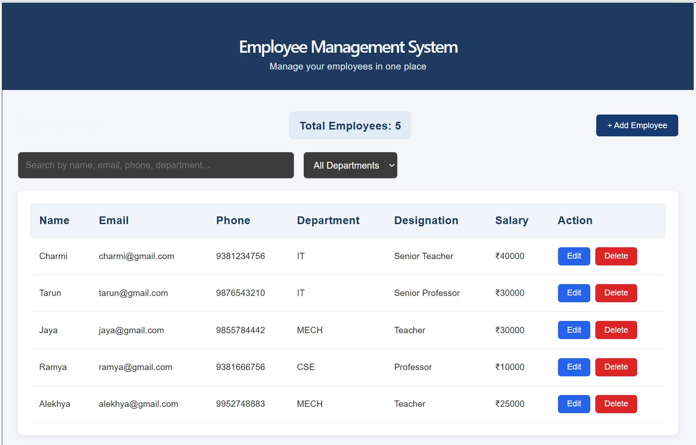
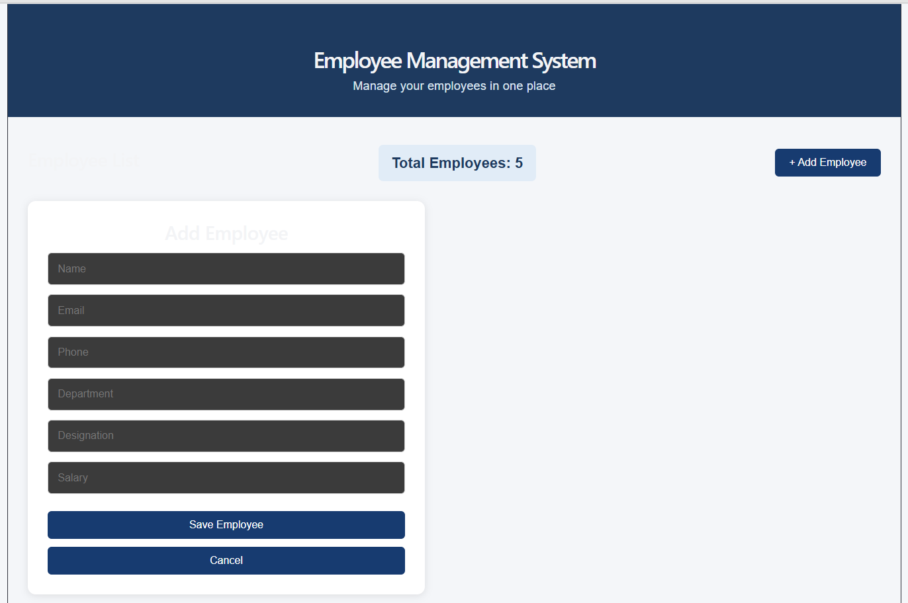
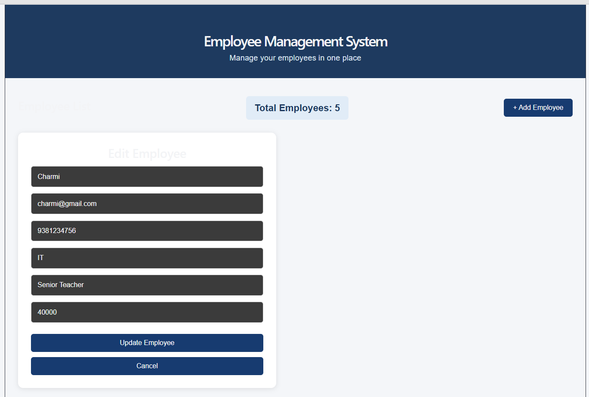
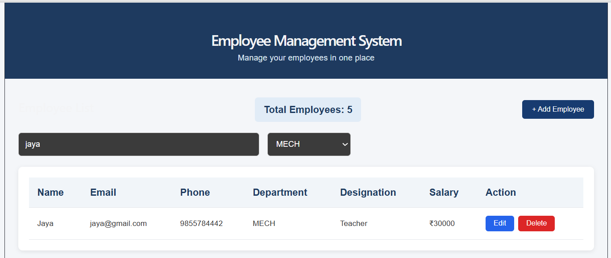
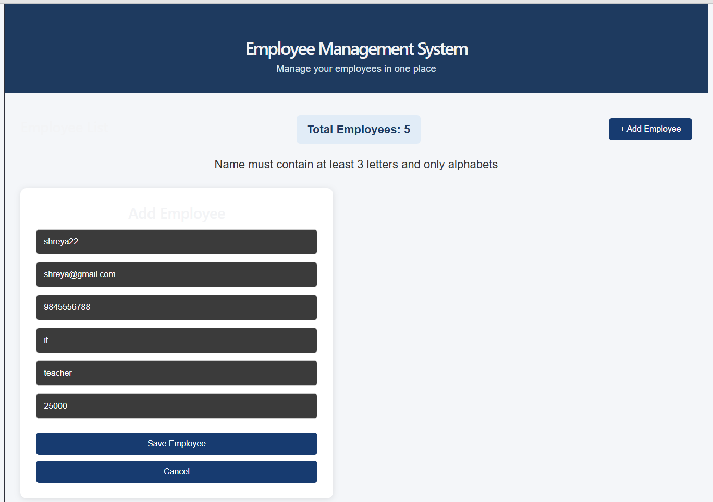
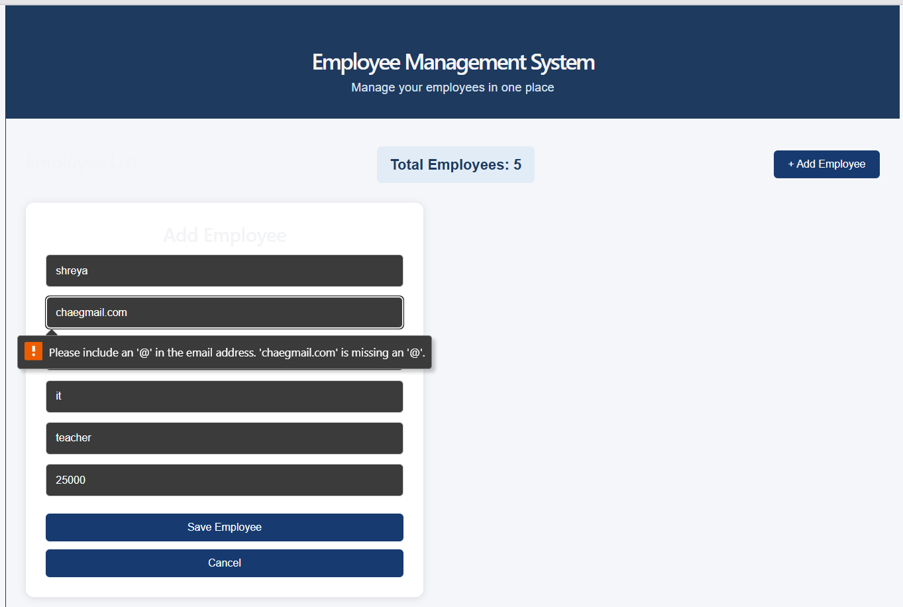
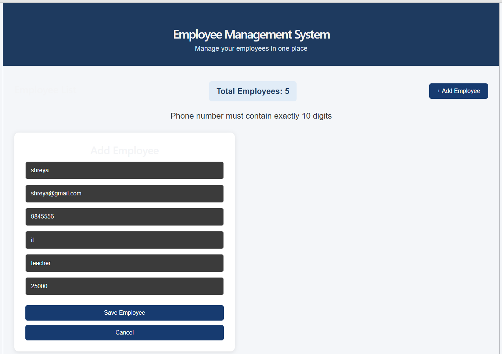
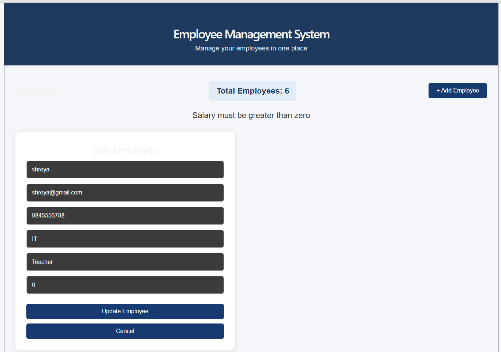
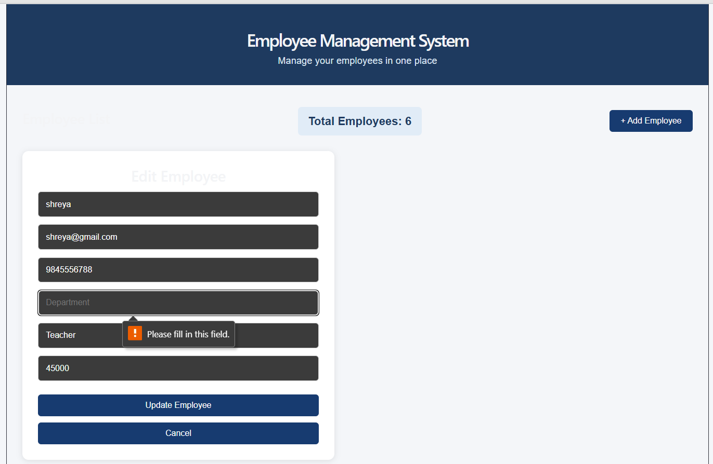

# Employee Management System

A full-stack web application to manage employee information efficiently. Users can add, view, update, delete, search and filter employee records through a user-friendly dashboard.

## Technologies Used

**Frontend**
- React.js
- HTML
- CSS
- JavaScript
- Vite

**Backend**
- Node.js
- Express.js

**Database**
- MongoDB
- Mongoose

**API Testing**
- Thunder Client

## Features

- Add new employees
- View all employees
- View employee details by ID
- Update employee information
- Delete employee records
- Search employees by name, email, phone, department and designation
- Filter employees by department
- Display total employee count
- Frontend form validation
- Backend data validation
- Duplicate email prevention
- User-friendly error messages

## Validations

- Employee name must contain at least 3 characters.
- Name must contain only letters and spaces.
- Email must have a valid format.
- Email addresses must be unique.
- Phone number must contain exactly 10 digits.
- Salary must be greater than zero.
- Required fields cannot be empty.

## Project Structure

```text
Employee-Management-System/
│
├── frontend/
│   ├── src/
│   └── package.json
│
├── backend/
│   ├── controllers/
│   ├── models/
│   ├── routes/
│   ├── config/
│   └── package.json
│
└── README.md
```

## Installation and Setup

### 1. Clone the repository


git clone https://github.com/chlakshmialekhya77/Employee-Management-System.git


### 2. Backend setup


cd backend
npm install


Configure your MongoDB connection in the `.env` file.

Start the backend:


npm start


Backend runs at:

`http://localhost:5000`

### 3. Frontend setup

Open another terminal:


cd frontend
npm install
npm run dev


Frontend runs at:

`http://localhost:5173/`

## API Endpoints

| Method | Endpoint | Description |
|---|---|---|
| POST | `/api/employees` | Add employee |
| GET | `/api/employees` | Get all employees |
| GET | `/api/employees/:id` | Get employee by ID |
| PUT | `/api/employees/:id` | Update employee |
| DELETE | `/api/employees/:id` | Delete employee |

## Database

MongoDB is used to store employee information, including:

- Name
- Email
- Phone
- Department
- Designation
- Salary
- Joining Date

## Author

**Alekhya Chintapalli**

Computer Science and Engineering Graduate

##  Project Status

Completed – Core Employee Management System functionality and validation implemented.


## Screenshots

### 1. Dashboard


### 2. Add Employee


### 3. Edit Employee


### 4. Search and Filter


### 5. Name Field Validation


### 6. Email Field Validation


### 7. Phone Number Field Validation


### 8. Salary Field Validation


### 9. Required Field Validation
